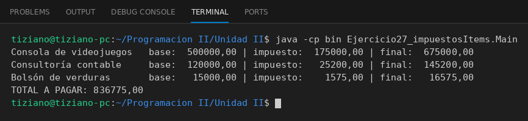

# ItemFacturable

Programación II - Unidad 2 - Ejercicio 27

## Consigna
Calcular impuestos de distintos ítems con una clase abstracta y fórmulas fiscales encapsuladas en cada subclase.

## Lógica
- Clase abstracta `ItemFacturable` con `nombre`, `precioBase`, el método abstracto `calcularImpuesto()` y el método concreto `calcularPrecioFinal()` (base + impuesto).
- `ProductoImportado` (35%), `ServicioProfesional` (21%) y `AlimentoBasico` (10,5%).
- `Main`: lista de ítems recorrida polimórficamente con el desglose y el total.

## Ejecución

